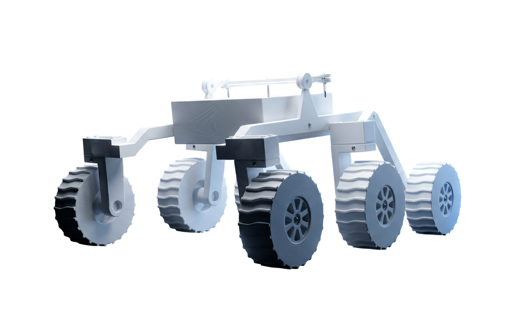

# Rover UNACH

**A 1:10 scale rover inspired by NASA's Curiosity, and the website that documents how we built it.**

This was our team project for Electricity and Electronics at UNACH (2nd semester). We built a small rover with Rocker-Bogie suspension, the same kind Curiosity uses to climb over rocks, controlled by an ESP32 that you drive from your phone.



## The rover

- **Suspension:** Rocker-Bogie with 6 wheels
- **Brain:** ESP32 with differential motor control and servo steering
- **Sensors:** HC-SR04 ultrasonic sensor to detect obstacles, plus a status LED
- **Control:** the ESP32 serves its own web page over WiFi, so you open a URL on your phone and drive. No app needed.

The firmware and wiring guide are in [`firmware/`](firmware/).

## The website

A one-page site that walks through the project: how the suspension works, every component, the electronics, the code, the build steps (with a render for each part) and the team.

Built with Next.js 14 as a static export, CSS Modules (one per component) and Framer Motion for the animations. It deploys as plain static files.

## Run it locally

```bash
npm install
npm run dev      # http://localhost:3000
npm run build    # static build in out/
```

The original Spanish README, with deploy and customization notes, is in [README.es.md](README.es.md).
